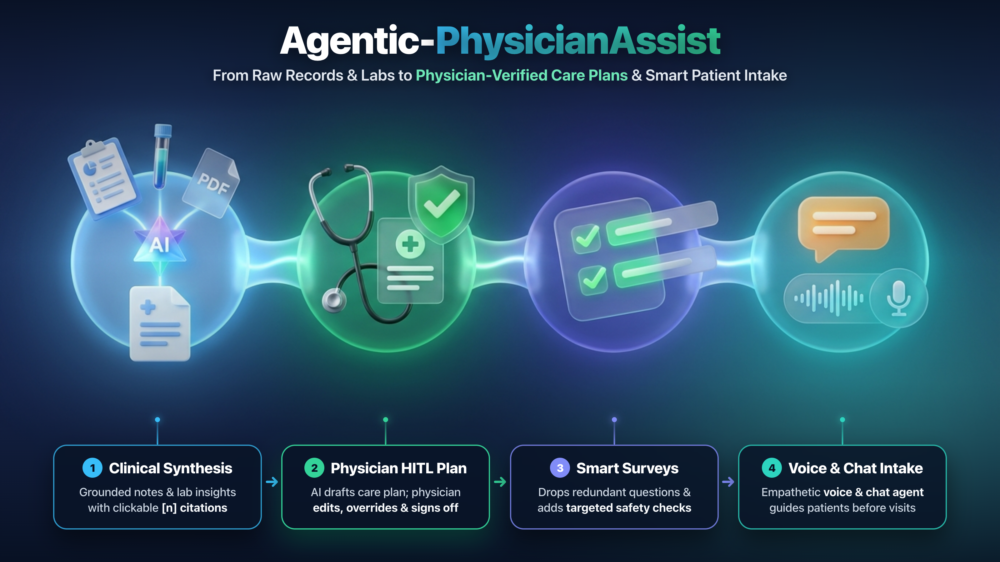
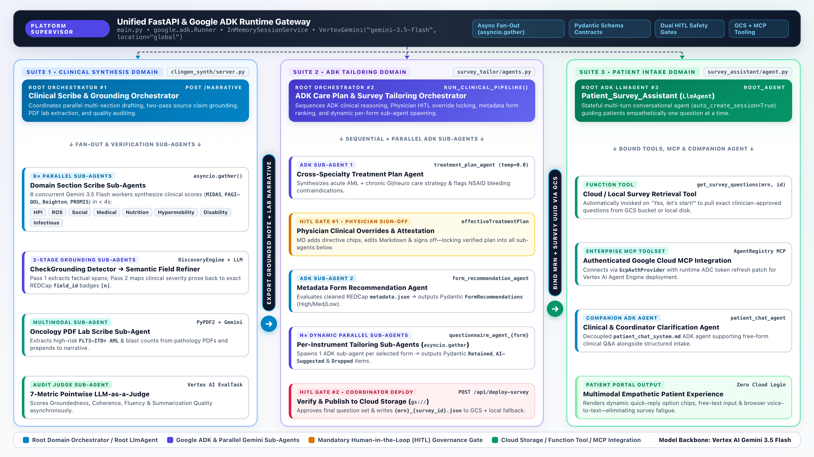

# Agentic-PhysicianAssist

This repository hosts the deployment infrastructure and synced assets for the demo.

It belongs to a demo available on [go/demos](http://goto.google.com/demos). The repository title follows the syntax `{demo_id}-{slugified_demo_title}`.

**ℹ️ Empty Directories:** Some directories in this repository might initially be empty. This happens if the demo does not yet include GitHub artifacts. The repository is provisioned automatically with these folders so you have a place to start adding click-to-deploy code or other demo-related code.

## Quick Start Guidelines

To ensure your contributions are preserved and automated syncs run smoothly, please use the appropriate directory below:

- **✅ Develop Click-to-Deploy Assets here:** `/click-to-deploy` **Active Workspace:** Use this directory to actively develop, update, and manage the demo's deployment scripts and click-to-deploy configurations. All pull requests for deployment capabilities should target this folder.
- **✅ Contribute Skills here:** `/skills` **Active Workspace:** This folder contains auto-generated skills available for the demo, but users are free to contribute additional skills.
- **✅ Add and modify other folders:** You are free to add and modify additional folders.
- **🚫 DO NOT modify this directory:** `/demo` **Automated Sync:** This directory is periodically overwritten by an automated sync from the upstream source repositories. These syncs are used for the versioning feature ([read more](http://go/demo-versioning)). Any manual changes made directly in this folder will be permanently lost on the next sync.

---

## Platform Overview



**Agentic-PhysicianAssist** is a closed-loop, Human-in-the-Loop (HITL) clinical intelligence platform built on **Google Cloud Vertex AI (`gemini-3.5-flash`)**, **Google Agent Development Kit (ADK)**, **Discovery Engine Grounding**, and **Vertex AI Evaluation**:

1. **Suite 1 — Grounded Clinical Scribe & Pathology PDF Synthesis (`services/clingen_synth`):** Synthesizes 8 clinical note sections concurrently in `< 4s` (`asyncio.gather`), maps claims to exact intake fields via clickable `[n]` citations, runs 7-metric LLM-as-a-Judge quality audits, and extracts acute oncology biomarkers (`FLT3-ITD+ AML`) from diagnostic PDFs.
2. **Suite 2 — Physician HITL Treatment Plan & Dynamic Survey Tailoring (`services/survey_tailor`):** Drafts cross-specialty care strategies (`Pending Physician HITL`), captures interactive **Physician Clinical Overrides & Sign-Off**, ranks priority REDCap instruments, and spawns parallel per-form ADK sub-agents to prune redundant questions while adding targeted safety checks.
3. **Suite 3 — Zero-Login Conversational Patient Intake (`services/survey_assistant`):** Tool- and MCP-equipped root ADK `LlmAgent` (`Patient_Survey_Assistant`) retrieves the clinician-approved survey from **Google Cloud Storage** and guides patients empathetically one question at a time via chips, text, or voice.



---

## Documentation, Presentations & Live Demo Assets

- **Full Technical & Setup Guide:** [`docs/README.md`](docs/README.md)
- **Step-by-Step Interactive Demo Script:** [`docs/DEMO_GUIDE.md`](docs/DEMO_GUIDE.md)
- **Live Application Demo Video (`1080p` MP4 with Voiceover):** [`docs/Agentic_PhysicianAssist_Demo_Video.mp4`](docs/Agentic_PhysicianAssist_Demo_Video.mp4)
- **Parallel Agentic Architecture & Functionality Presentation (`.pptx` / `.html`):**
  - [`docs/Agentic_PhysicianAssist_Architecture_Presentation.pptx`](docs/Agentic_PhysicianAssist_Architecture_Presentation.pptx)
  - [`docs/Agentic_Architecture_and_Functionality_Presentation.html`](docs/Agentic_Architecture_and_Functionality_Presentation.html)
- **Executive Live Demo Walkthrough Presentation (`.pptx` / `.html`):**
  - [`docs/Agentic_PhysicianAssist_Demo_Presentation.pptx`](docs/Agentic_PhysicianAssist_Demo_Presentation.pptx)
  - [`docs/demo_presentation.html`](docs/demo_presentation.html)

## Quick Launch

```bash
# Run locally (FastAPI Backend + React/Vite Frontend)
make run

# Deploy to Google Cloud Run via Terraform
make deploy
```
