# Agentic-PhysicianAssist — End-to-End Demo Guide

> **Demospace Reference:** `https://demospace.corp.goog/demo/Agentic-PhysicianAssist/2257`  
> **Hosted Demo Environment:** `https://demo-2257.1987984870407.demo.altostrat.com`  
> **Estimated Duration:** **10–12 minutes** (Full Walkthrough) | **3–4 minutes** (Executive Express Track)  
> **Target Audience:** Chief Medical Information Officers (CMIOs), Physicians & Clinical Leads, Research/Clinical Coordinators, Healthcare IT & AI Architects

---

## 1. Demo Purpose & Executive Summary

**Agentic-PhysicianAssist** is an AI assistant for physicians—built with **Human-in-the-Loop (HITL)** governance—that turns high-volume, fragmented patient records and intake questionnaires into grounded, actionable clinical intelligence.

| Core Capability | What It Does | Key Differentiator |
| :--- | :--- | :--- |
| **1. Patient Narratives** | Turns lengthy patient intake questionnaires and unstructured clinical history into structured, medically dense narratives with inline citations (`[1]`, `[2]`) and automated confidence/audit scores. | Clinicians can click any claim to highlight the exact underlying source field (*"Trust, but Verify"*). |
| **2. Physician Notes** | Drafts multi-domain clinical notes (8 core clinical sections + ambient hematopathology/oncology lab PDF synthesis) ready for physician review and sign-off. | High-concurrency generation (`asyncio.gather` + Gemini 3.5 Flash) synthesizes all 8 sections simultaneously. |
| **3. Next-Visit Questionnaires & Survey Assistant** | Generates personalized follow-up questionnaires—retaining relevant items, dropping non-applicable ones, and suggesting precision safety questions—paired with a multimodal voice/text **Intelligent Survey Assistant** for patients. | Eliminates patient survey fatigue while ensuring critical medication and symptom risks are captured pre-visit. |

---

## 2. The Problem We Solve

Before **Agentic-PhysicianAssist**, clinical intake and pre-visit preparation break down across three bottlenecks:

1. **Physician "Pajama Time" & Dense Chart Review:** Clinicians and coordinators spend hours after clinic manually reviewing fragmented registry JSONs, long intake forms, and lab PDFs to piece together History of Present Illness (HPI) and Review of Systems (ROS) notes.
2. **Rigid, Untailored Follow-Up Forms:** Coordinators select from static survey catalogs with zero adaptation to a patient's active comorbidities, lab findings, or medication risks.
3. **Patient Survey Fatigue & Dropouts:** Patients receive massive, generic questionnaires full of irrelevant questions—driving high abandonment rates, incomplete pre-visit context, and unfocused appointments.

---

## 3. Value Proposition (Key Talking Points)

### Business Value
- **Gives Physicians Back "Pajama Time":** Cuts the after-hours burden of gathering and synthesizing scattered patient history so physicians focus on treatment rather than paperwork.
- **Reduces Clinician Burnout:** Offloads repetitive pre-visit, post-visit, and handover documentation—supporting clinician satisfaction and retention.
- **Lifts Care Team Productivity:** Nurses and clinical/research coordinators spend minutes instead of hours preparing charts and assembling follow-up instruments.
- **Improves the Patient Experience:** Shortened, personalized questionnaires delivered through an empathetic conversational assistant cut survey fatigue and make clinic visits sharper and more focused.
- **Builds Clinical Trust:** Inline source citations, automated LLM-as-a-Judge evaluation scores, and mandatory HITL approval keep clinicians in full control—critical for adoption in regulated healthcare environments.

### Technical Value
- **Reusable Across Specialties:** Driven by decoupled questionnaire metadata (`data/metadata.json`) and modular markdown prompts (`prompts/*.md`)—new medical specialties can be onboarded by swapping schemas and prompts with **zero application rebuild**.
- **Specialty & Workflow Agents Working Together:** Built on **Google Agent Development Kit (ADK)** and orchestrated by **Gemini 3.5 Flash** on **Vertex AI**, coordinating specialized agents (`treatment_plan_agent`, `form_recommendation_agent`, `questionnaire_agent`, and `Patient_Survey_Assistant`).
- **Works With Diverse Clinical Data Sources:** Ingests structured questionnaire/registry JSON, unstructured clinical narratives, EHR/FHIR exports, and diagnostic PDF lab reports (`sample_oncology.pdf`).
- **Low Latency in Production:** Unified **FastAPI** gateway on **Google Cloud Run** uses asynchronous parallel execution (`asyncio.gather`) and Google Cloud Storage (GCS) + Model Context Protocol (MCP) synchronization for responsive real-time workflows.
- **Continuous Quality & Governance:** Combines a **Human-in-the-Loop (HITL)** coordinator review workbench with the **Vertex AI Evaluation Framework** (pointwise *Groundedness, Coherence, Fluency,* and *Diagnostic Text Quality* metrics) to validate output quality continuously and across model upgrades.

---

## 4. Three-Pillar Application Architecture

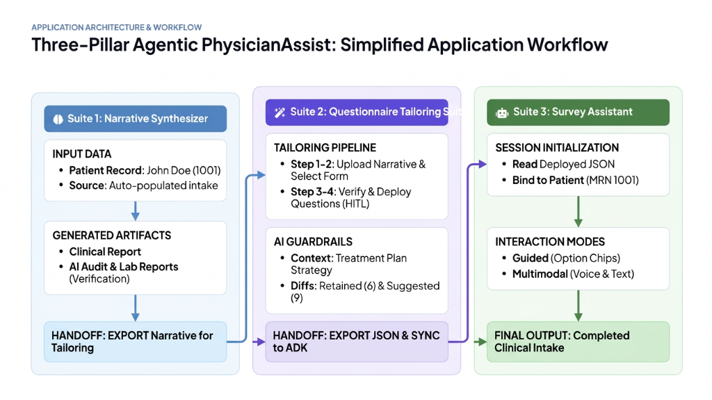

```mermaid
flowchart LR
    subgraph S1["Suite 1: Narrative Synthesizer"]
        A["Patient Record (MRN 1001)\nAuto-Populated Intake + Lab PDF"] --> B["Gemini 3.5 Flash\n(8 Parallel Sections)"]
        B --> C["Discovery Engine Grounding\n+ Vertex AI Eval Audit"]
    end

    subgraph S2["Suite 2: Questionnaire Tailoring Suite (ADK)"]
        D["treatment_plan_agent\nClinical Care Strategy"] --> E["form_recommendation_agent\nPriority Form Selection"]
        E --> F["questionnaire_agent\nRetained / Suggested / Dropped"]
        F --> G["HITL Coordinator Approval\n+ GCS JSON Sync"]
    end

    subgraph S3["Suite 3: Intelligent Survey Assistant (ADK)"]
        H["Patient_Survey_Assistant\nReads GCS Survey via Tool/MCP"] --> I["Guided Intake\nOption Chips + Voice & Text"]
    end

    C -- "Export to Survey Tailoring" --> D
    G -- "Launch Chatbot Portal" --> H
```

---

## 5. Pre-Demo Setup & Sample Patient Context

### Pre-Flight Checklist
1. Open the hosted demo URL (`https://demo-2257.1987984870407.demo.altostrat.com`) or launch locally (`make run` / `python main.py` after authenticating with `gcloud auth application-default login`).
2. Ensure browser **microphone permissions** are allowed if you plan to demonstrate live voice-to-text in Suite 3.
3. Verify pop-ups/new tabs are permitted (clicking **Launch Chatbot Portal** opens the patient portal in a new tab).

### Know Your Demo Patient: **John Doe (`MRN: 1001`)**
Having quick command of John Doe's clinical profile makes your narration sound authentic:
- **Demographics:** 47-year-old male Software Engineer, referred by Dr. Smith.
- **Neurological:** Severe acute-on-chronic migraines (`MIDAS Score: 35` — severe disability), persistent headache & photophobia (pain `6/10`), taking oral `Ibuprofen 400mg` PRN and `Lisinopril 10mg` daily; denies CGRP inhibitors.
- **Gastrointestinal & Nutritional:** Severe **gastroparesis** (`45% gastric retention at 4 hours`), postprandial vomiting within 1 hour of eating, `15 lb` unintentional weight loss, dependent on **TPN, G-tube, and J-tube** (`PAGI-QOL: 1.8`).
- **Systemic / Connective Tissue:** **Hypermobile Ehlers-Danlos Syndrome (hEDS)** (`Beighton Score: 7/9`), **Mast Cell Activation Syndrome (MCAS)**, GERD, post-COVID syndrome, profound fatigue (`PROMIS Fatigue T-score: 75.8`).
- **New Diagnostic Lab PDF (`Lab Reports` tab):** Hematopathology report revealing **Acute Myeloid Leukemia (AML)** (WBC `42.5 × 10³/µL`, `24%` circulating myeloid blasts, **FLT3-ITD positive**).

---

## 6. Click-by-Click Live Demo Walkthrough

### Act 1 — Suite 1: Grounded Clinical Narrative & Diagnostic Lab Synthesis

#### Step 1: Select Sample Patient `John Doe (1001)`
- **Where to Click:** On the **Clinical Notes Dashboard**, click the **John Doe (`1001`)** patient card (`100% Survey Completion`).
- **What Happens:** Opens the **Clinical Review** workspace for `Patient Id: 1001` with the **Patient Questionnaire (Source Node)** drawer on the right.
- **Talk Track:** *"We start in the physician's Intelligent Synthesis Hub. John Doe (MRN 1001) has completed a complex multi-system pre-visit questionnaire—covering GI, neurology, hypermobility, and functional scores that would normally take a clinician 15–20 minutes just to parse."*

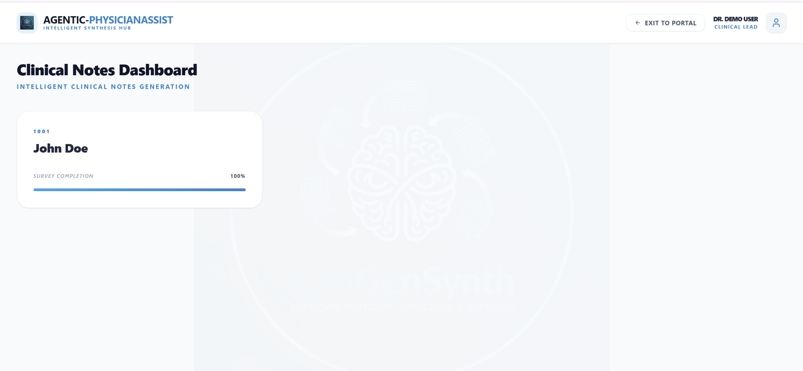

---

#### Step 2: Auto-Populate Source Intake & Run Parallel Synthesis
- **Where to Click:**
  1. In the right-hand **Patient Questionnaire** panel, toggle **Auto-Populate Questionnaire** to **ON**.
  2. Click the center blue **Run Note Generation Pipeline** button.
- **What Happens:** All structured registry and intake fields populate on the right, and the backend fires **8 concurrent Gemini 3.5 Flash + Discovery Engine Grounding pipelines** via `asyncio.gather` (completing in ~1–2 minutes with live grounding refinement, or seconds on cached/fast endpoints).
- **Talk Track:** *"Instead of generating sections one-by-one, Agentic-PhysicianAssist dispatches 8 specialized clinical section generators in parallel while cross-checking every claim against the structured patient record."*

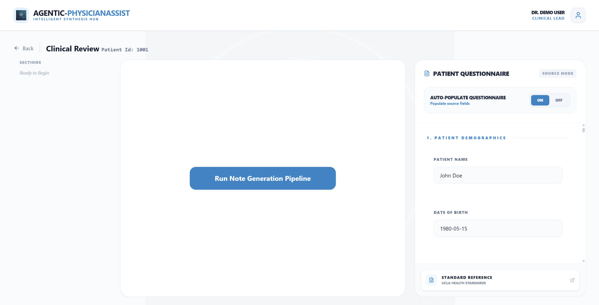

---

#### Step 3: Inspect Grounded Clinical Notes & Interactive Citations
- **Where to Click:**
  1. Use the left **Sections** navigation rail to browse the 8 generated clinical domains (*History of Present Illness, Review of Systems, Social History, Medical History, Nutritional & Functional Status, Systemic Hypermobility, Disability, Infectious Disease History*).
  2. Click any superscript citation badge (e.g., **`[1]`**, **`[3]`**, **`[7]`**) inside the prose.
- **What Happens:** Clicking a citation smoothly scrolls and highlights the exact raw field in the right-hand **Patient Questionnaire** panel (e.g., mapping *"severe disability from migraines"* directly to `midas_score: 35` or *"45% retention"* to `gastric_emptying_scan`).
- **Talk Track:** *"Notice two things: first, Gemini interprets clinical indices like MIDAS 35, Beighton 7/9, and PROMIS Fatigue 75.8 into formal medical prose. Second, there is zero AI black box—clicking any citation `[3]` immediately highlights the exact source answer on the right so the physician can verify before signing off."*

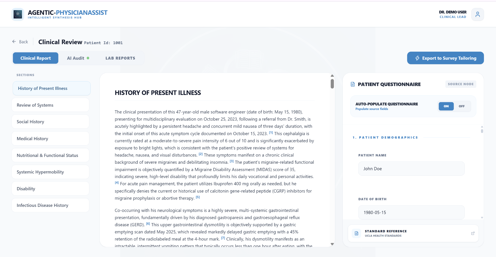

---

#### Step 4: Verify Quality in the `AI Audit` Tab (LLM-as-a-Judge)
- **Where to Click:** Click the **AI Audit** tab (notice the pulsing green status dot once the background audit finishes).
- **What Happens:** Displays real-time **Vertex AI Evaluation Framework** KPIs across all sections:
  - **Clinical Grounding (%)** with per-section verification bars
  - **Logic Coherence (`/ 5`)**
  - **Prose Fluency (`/ 5`)**
  - **Overall Diagnostic Quality (`/ 5`)**
- **Talk Track:** *"In regulated healthcare environments, trust requires measurable governance. Behind the scenes, Vertex AI's Evaluation Task runs pointwise LLM-as-a-Judge audits across every section—giving clinical leads objective Groundedness, Coherence, and Fluency scores."*

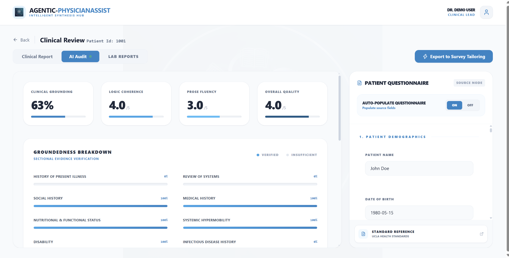

---

#### Step 5: Synthesize Diagnostic PDF Lab Reports into the Clinical Note
- **Where to Click:**
  1. Click the **LAB REPORTS** tab to preview the embedded hematopathology PDF report (`sample_oncology.pdf`).
  2. Click **USE LAB REPORT FOR NARRATIVE** at the top right of the PDF viewer.
- **What Happens:** An Oncology Scribe prompt extracts peripheral blood & molecular findings from the PDF (`WBC 42.5 × 10³/µL`, `24%` myeloid blasts, **FLT3-ITD mutation**) and prepends a structured **Oncology Lab Interpretation** section directly to the top of the **Clinical Report**.
- **Talk Track:** *"Patients rarely arrive with questionnaire data alone—critical context lives in PDF lab and pathology reports. With one click, our Oncology Scribe digests the hematopathology PDF, identifies high-risk FLT3-ITD+ Acute Myeloid Leukemia, and weaves it directly into the clinical note."*

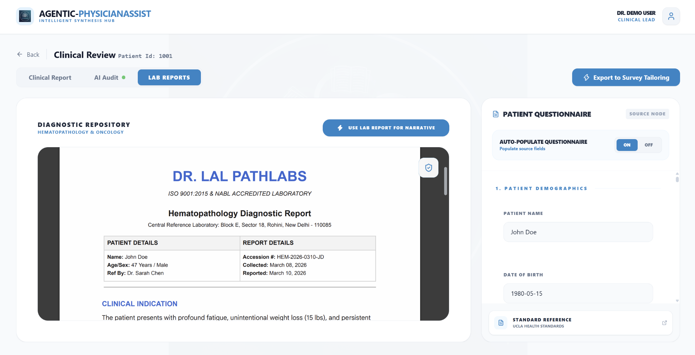

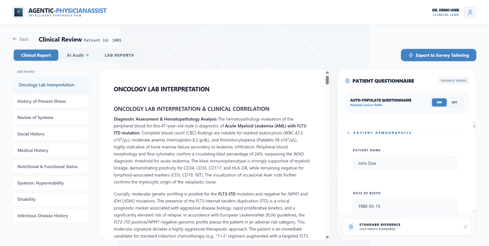

---

#### Step 6: Handoff to Suite 2 (`Export to Survey Tailoring`)
- **Where to Click:** Click the blue **Export to Survey Tailoring** button in the top-right corner.
- **What Happens:** Packages the synthesized multi-section clinical narrative (including the Oncology Lab Interpretation) for `MRN: 1001` and transitions seamlessly into **Suite 2: Clinical Survey Intelligence (Tailoring Suite)**.
- **Talk Track:** *"Now that the physician's narrative is ready, how do we prepare for John's follow-up without burying him in 100 generic questions? Let's hand this synthesized record off to our ADK Questionnaire Tailoring agents."*

---

### Act 2 — Suite 2 (Part A): ADK Treatment Plan & Intelligent Form Selection

#### Step 7: Review the `AI-Generated Treatment Plan` & Patient Dossier
- **Where to Click:** Observe Stage 2 (**AI Analysis & Select**) in the **Patient Analysis Workspace**; optionally click **View Patient Narrative (1)** to inspect the handed-off dossier.
- **What Happens:** The ADK `treatment_plan_agent` synthesizes an actionable **Clinical Strategy & Treatment Plan**—flagging both urgent oncologic priorities (FLT3-ITD+ AML) and critical comorbidity interactions (e.g., discontinuing oral Ibuprofen 400mg and oral migraine meds because severe gastroparesis compromises absorption and irritates gastric mucosa).
- **Talk Track:** *"Before picking a single survey question, our ADK `treatment_plan_agent` formulates a clinical care strategy. It catches cross-specialty interactions—for instance, recognizing that oral Ibuprofen is unsafe and poorly absorbed in a TPN-dependent gastroparesis patient."*

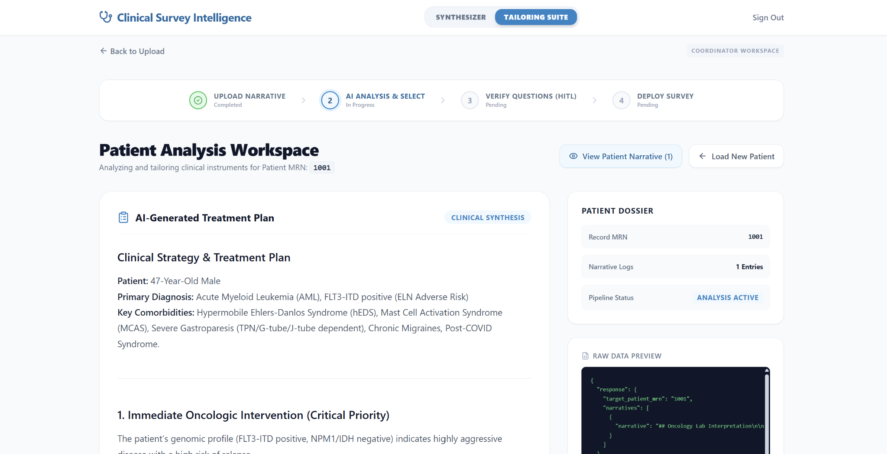

---

#### Step 8: Select AI-Recommended Survey Forms & Trigger Tailoring
- **Where to Click:**
  1. Scroll down to **Survey Form Customization** and review the **AI-Recommended Forms** pre-selected by `form_recommendation_agent` with **HIGH PRIORITY** and **MEDIUM PRIORITY** badges and clinical rationales (e.g., *Review Systems*, *Promis Questionnaire*, *Medications*, *Clinical Screening*).
  2. Toggle checkboxes to refine the selection if desired (keeping 2–3 forms selected makes live tailoring fastest).
  3. Click **Trigger Questionnaire Customization** at the bottom.
- **What Happens:** Dispatches the ADK `questionnaire_agent` across the selected form schemas in parallel, cross-referencing every template question against John Doe's narrative and treatment plan.
- **Talk Track:** *"Instead of coordinators hunting through dozens of departmental forms, `form_recommendation_agent` ranks the exact instruments needed with clinical rationales. Because this is schema-driven, onboarding a brand-new specialty department is as simple as swapping the form metadata JSON."*

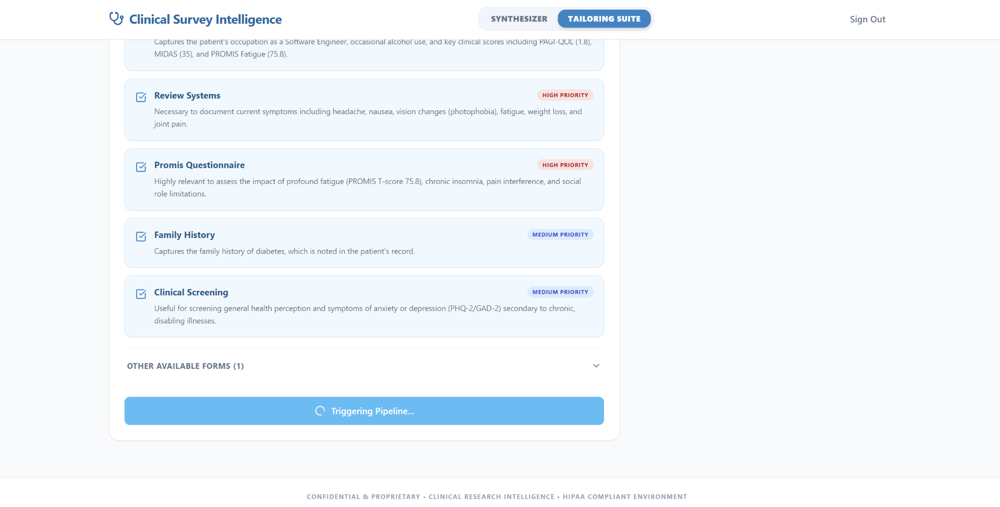

---

### Act 3 — Suite 2 (Part B): Human-in-the-Loop (HITL) Verification & Deployment

#### Step 9: Review `Retained` Questions & Treatment Plan Guardrails
- **Where to Click:** Advance to Stage 3 (**Verify Questions (HITL)**) and inspect the **Retained** tab alongside the right-hand **Treatment Plan Context** card.
- **What Happens:** Shows all baseline template questions verified as clinically relevant to `MRN: 1001`, grouped cleanly by form with underlying `Field ID` mappings preserved for downstream EHR/registry sync, while **Dropped** questions (if any) include explicit 1-to-1 clinical rationales.
- **Talk Track:** *"Here is our Human-in-the-Loop workbench. Standard template questions that matter for John are retained with their exact database field IDs intact, while irrelevant questions are filtered out so we respect the patient's time."*

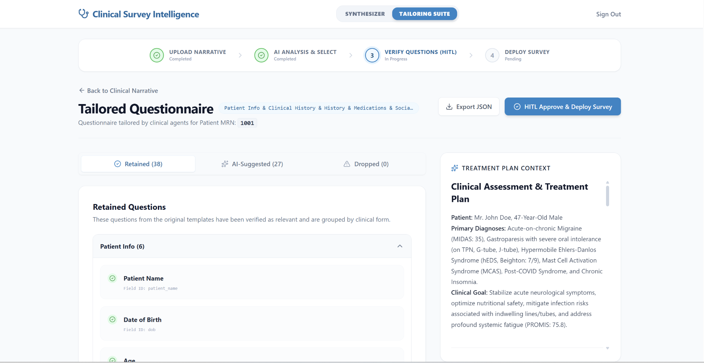

---

#### Step 10: Inspect `AI-Suggested` Precision Questions & Optional JSON Export
- **Where to Click:**
  1. Click the **AI-Suggested** tab.
  2. *(Optional)* Click **Export JSON** at the top right to download an offline copy (`tailored_<forms>_mrn_1001.json`).
- **What Happens:** Displays brand-new precision clinical questions generated specifically for gaps and risks in John's care plan—complete with structured answer option pills (e.g., screening for side effects of non-oral migraine rescue therapies, verifying discontinuation of oral Ibuprofen, or checking for Lisinopril-induced persistent dry cough/lightheadedness).
- **Talk Track:** *"This is where agentic tailoring shines: standard forms wouldn't know to ask whether John successfully stopped oral Ibuprofen to protect his gastric lining or whether Lisinopril is causing dizziness. The ADK agent synthesizes these targeted safety checks automatically."*

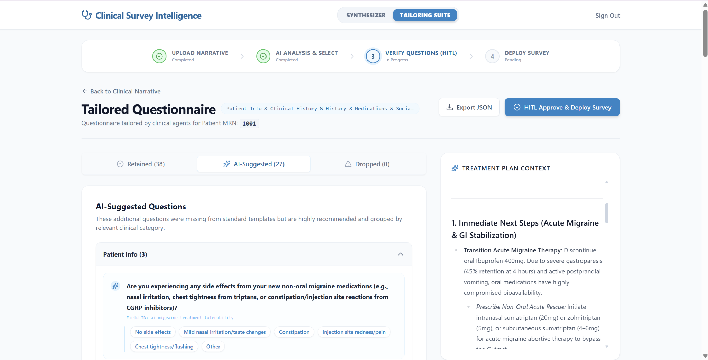

---

#### Step 11: Approve & Deploy Custom Survey to GCS + ADK
- **Where to Click:**
  1. Click the blue **HITL Approve & Deploy Survey** button in the top-right header.
  2. Click **OK** on the browser confirmation dialog (*"Survey deployed successfully! The custom survey has been written to GCS and integrated with the local ADK assistant."*).
- **What Happens:** Writes the approved questionnaire JSON (`Retained + AI-Suggested` questions) to Google Cloud Storage (`gs://.../deployed_surveys/1001_<survey_id>.json`) and displays the **Active Local Deployment** banner with a unique patient portal link and **Launch Chatbot Portal** button.
- **Talk Track:** *"Nothing reaches the patient without human sign-off. Once the coordinator clicks Approve & Deploy, the tailored JSON schema is persisted to Google Cloud Storage and bound to MRN 1001 for our conversational ADK agent."*

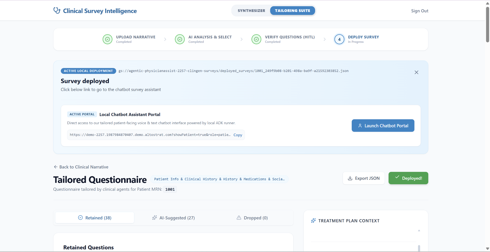

---

### Act 4 — Suite 3: Conversational Patient Intake (`Intelligent Survey Assistant`)

#### Step 12: Launch the Patient Chatbot & Complete Multimodal Intake
- **Where to Click:**
  1. Click **Launch Chatbot Portal** (opens the full-screen **Intelligent Survey Assistant** bound to `Patient MRN: 1001`).
  2. Click the **`Yes, let's start!`** quick-reply chip.
  3. Answer 1–2 questions using **Quick-Reply Option Chips**, **free-text**, or the **Microphone (Voice-to-Text)** icon in the input bar.
- **What Happens:**
  - The ADK `Patient_Survey_Assistant` agent fetches the custom survey JSON from Google Cloud Storage (`get_survey_questions` / GCS MCP toolset) using `MRN: 1001` and `survey_id`.
  - It walks the patient through questions **strictly one at a time**, presenting selectable option chips where applicable, explaining medical terms in plain language if asked, and validating discomfort or symptoms empathetically—without requiring corporate cloud IAM logins for external patients.
- **Talk Track:** *"Finally, look at the patient experience. Instead of a daunting 10-page clipboard form, John opens a clean link—no complex cloud login required—and chats by voice, text, or quick-reply chips. The ADK assistant pulls the exact tailored survey we just approved from Cloud Storage, asks one question at a time with clinical empathy, and captures structured responses ready for the physician's next visit."*

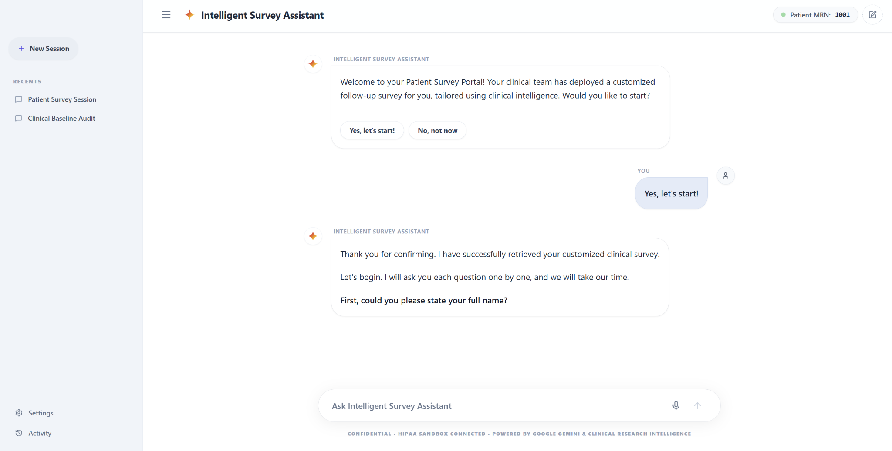

---

## 7. Executive 3-Minute "Express Demo" Track

Short on time? Hit these **4 high-impact beats** in under 4 minutes:
1. **Grounded Speed & Citations (60s):** Select `John Doe (1001)` → Toggle **Auto-Populate ON** → Click **Run Note Generation Pipeline** → Click citation `[3]` in **History of Present Illness** to highlight source grounding, then flash **AI Audit** KPIs.
2. **Ambient Lab PDF Synthesis (45s):** Open **LAB REPORTS** → Click **USE LAB REPORT FOR NARRATIVE** → Show **Oncology Lab Interpretation** (AML / FLT3-ITD) prepended to the note → Click **Export to Survey Tailoring**.
3. **Agentic Tailoring + HITL (60s):** Show the **AI-Generated Treatment Plan** → Click **Trigger Questionnaire Customization** on pre-selected High-Priority forms → Show **AI-Suggested** precision medication safety questions → Click **HITL Approve & Deploy Survey**.
4. **Conversational Patient Intake (45s):** Click **Launch Chatbot Portal** → Click **`Yes, let's start!`** → Respond via option chip or voice microphone to demonstrate empathetic, zero-fatigue patient intake.

---

## 8. Customer FAQ & Objection Handling

| Question | Recommended Answer |
| :--- | :--- |
| **How do you prevent hallucinations in clinical notes?** | Three layers: (1) strict source-only prompting on Gemini 3.5 Flash, (2) claim-level verification via **Google Cloud Discovery Engine Grounding** (`CheckGroundingRequest`) mapped to exact field IDs with clickable `[n]` citations, and (3) automated **Vertex AI Evaluation** groundedness scoring before mandatory physician sign-off. |
| **How hard is it to onboard a new clinical specialty (e.g., Cardiology, Oncology, Rheumatology)?** | Zero code rebuild is required. Form definitions live in `data/metadata.json` and agent instructions live in decoupled markdown files (`prompts/*.md`). Swapping a department's questionnaire schema and specialty prompt guidelines immediately adapts all three suites. |
| **Can this integrate with Epic, FHIR, or REDCap?** | Yes. The FastAPI ingestion layer accepts standard JSON, unstructured clinical notes, REDCap data dictionaries/exports, and FHIR bundles, while preserving original `field_name` identifiers throughout tailoring so completed responses map cleanly back to the source registry or EHR. |
| **Do patients need Google Cloud IAM accounts to use the Survey Assistant?** | No. The custom web portal binds sessions via secure URL parameters (`mrn` & `survey_id`) mediated by the FastAPI + ADK backend using Application Default Credentials (ADC), allowing seamless embedding behind any health system's existing patient portal and consent workflow. |
